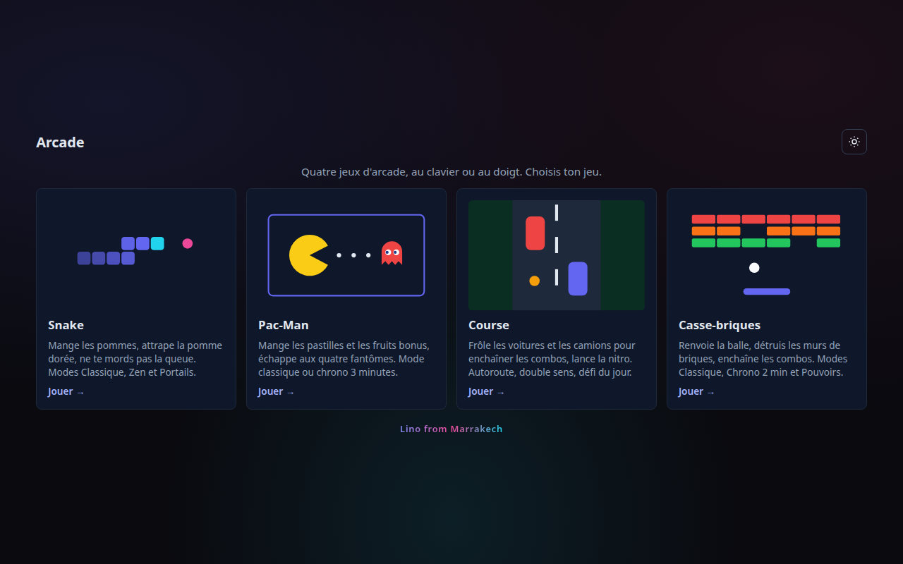
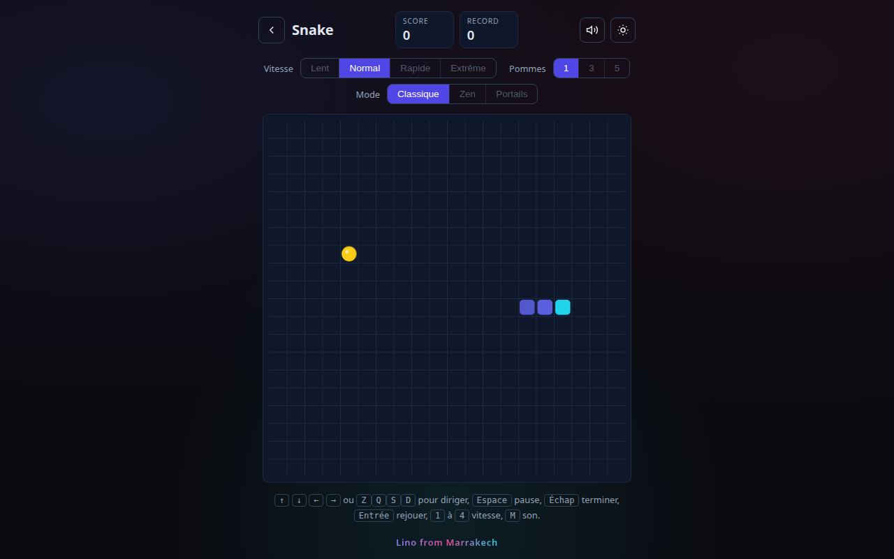
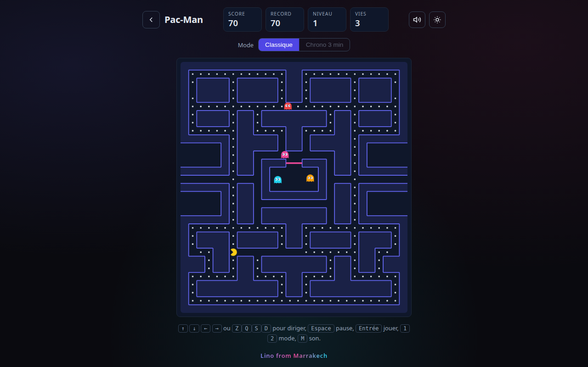
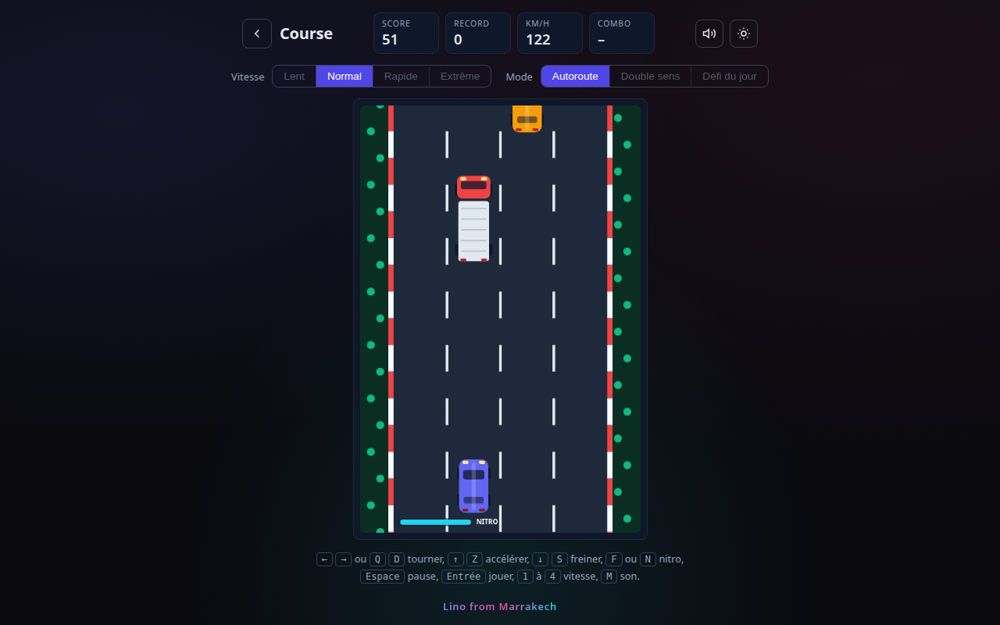
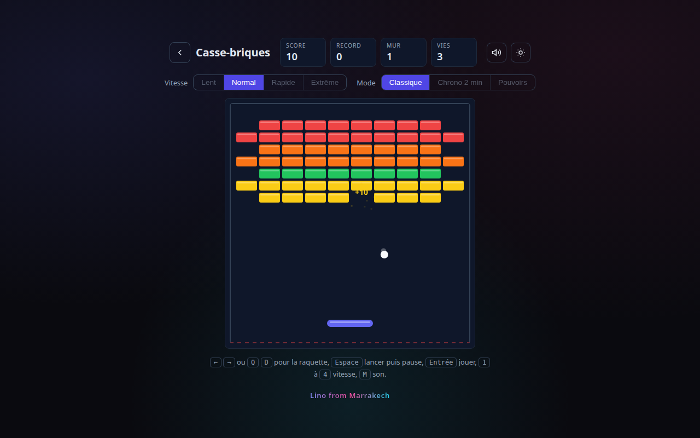

# Arcade

Four browser games, playable on desktop and mobile, even offline: **Snake**,
**Pac-Man**, **Course** (a car racing game) and **Casse-briques** (Breakout).
Plain HTML, CSS and native ES modules, no framework and no build step, deployed
to GitHub Pages.

**Play:** <https://fschmutz.github.io/ARCADE-GAMES/>

> **This wiki is generated.** Every page here is a file in the `wiki/` directory
> of [`fschmutz/ARCADE-GAMES`](https://github.com/fschmutz/ARCADE-GAMES),
> published by `.github/workflows/wiki.yml` on each push to the default branch.
> **Edits made in the GitHub wiki UI are overwritten** by the next sync.
> To change a page, edit the matching file in `wiki/` and open a pull request.

## Start here

- **[Getting Started](Getting-Started)** — run the games locally, the checks
  every change passes, and the repository settings the pack expects.
- **[Bundles](Bundles)** — what runs on every pull request, what ships switched
  off, and how to turn each one on or remove it.
- **[Architecture Decisions](Architecture-Decisions)** — why the repository is
  shaped this way, and what the alternatives were.

## Screenshots

Captured from the real site by `npm run screenshots` (system Chrome, dark
theme, 1280 × 800). Screenshots are mandatory, see
[ADR-0002](ADR/0002-Screenshots-Are-Mandatory).

## How it is built

| Part                   | What it is                                                                      |
| ---------------------- | ------------------------------------------------------------------------------- |
| `site/`                | The deployed tree: one page per game, the home page, 404, sitemap, `sw.js`      |
| `site/assets/`         | Shared modules: theme and input (`arcade.js`), Web Audio (`audio.js`), `fx.js`  |
| `site/<game>/rules.js` | Pure rules and data, no DOM, unit-tested                                        |
| `tests/`               | `node --test` for rules and the page contract; Playwright for desktop and touch |
| `ci.yml`               | Arcade gates, template checks, and the Pages deploy with a live smoke test      |

Every page carries a strict Content Security Policy, and the page contract
(`tests/unit/pages.test.js`) checks metadata, links, the sitemap and the offline
cache list. The full rules are in
[`AGENTS.md`](https://github.com/fschmutz/ARCADE-GAMES/blob/main/AGENTS.md) §11.

## How this wiki works

|                     |                                                                       |
| ------------------- | --------------------------------------------------------------------- |
| Source of truth     | `wiki/` in the repository                                             |
| Published by        | `.github/workflows/wiki.yml` → `scripts/wiki-sync.sh`                 |
| Trigger             | push to the default branch touching `wiki/**`, or a manual run        |
| Page name           | the filename, with `-` rendered as a space                            |
| Links between pages | the page name, not the filename: `[Getting Started](Getting-Started)` |

Adding a page is one file: create `wiki/My-Page.md`, open a pull request, and the
merge publishes it. Deleting the file deletes the page — the sync mirrors, it does
not merge.

## Why a wiki next to Pages

GitHub Pages here serves the product, the games in `site/`, not documentation.
The documentation has one surface, this wiki, so it never drifts against a
second copy. `docs/` holds only `docs/screenshots/`, images and no prose, and CI
fails on anything else there.

## Repository documents

Some documents stay in the repository rather than the wiki, because GitHub renders
them in the interface where they matter:

- [`README.md`](https://github.com/fschmutz/ARCADE-GAMES/blob/main/README.md) — the games, the controls, how it is built
- [`CONTRIBUTING.md`](https://github.com/fschmutz/ARCADE-GAMES/blob/main/CONTRIBUTING.md) — ground rules, branch, commit, and pull request conventions
- [`AGENTS.md`](https://github.com/fschmutz/ARCADE-GAMES/blob/main/AGENTS.md) — the same conventions, as a contract for AI assistants
- [`SECURITY.md`](https://github.com/fschmutz/ARCADE-GAMES/blob/main/SECURITY.md) — how to report a vulnerability privately
- [`SUPPORT.md`](https://github.com/fschmutz/ARCADE-GAMES/blob/main/SUPPORT.md) — where to ask a question that is not a vulnerability
- [`CHANGELOG.md`](https://github.com/fschmutz/ARCADE-GAMES/blob/main/CHANGELOG.md) — what changed and when
